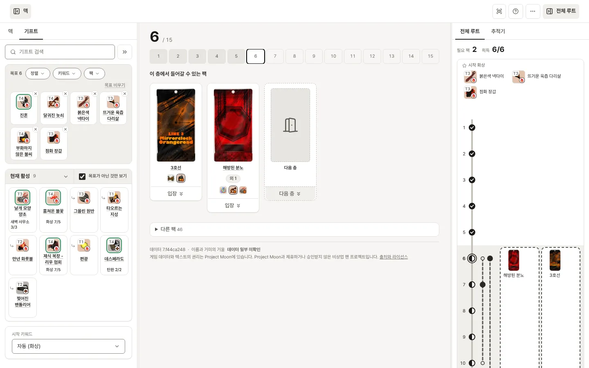

<!-- 이 파일은 docs/copy.md의 「README」에서 `npm run copy`가 만듭니다. 고칠 때는 그 파일을 고치세요. -->
# 거울 던전 루트 플래너

림버스 컴퍼니 **거울 던전**에서 쓰려는 덱과 원하는 E.G.O 기프트를 고르면, 그 기프트를 모으기 위한 **층별 테마팩 루트**를 계산해 주는 웹 도구입니다.

거울 던전의 기프트는 어느 팩에서나 나오는 범용 드랍과 특정 테마팩에서만 나오는 전용 기프트로 갈리고, 일부는 서로 다른 팩에서 얻은 재료를 조합해야 합니다. 게다가 테마팩은 정해진 층에서만 등장합니다. 그래서 "이 기프트들을 원한다"가 정해지면 **어느 층에서 어느 팩에 들어가야 하는지**가 따라 정해집니다. 이 도구가 그 계산을 합니다.

## 무엇을 해 주나

- 덱(인격 12인)을 고르거나 게임의 **편성 코드**를 붙여넣어 불러오기
- 목표 기프트 정하기 — 키워드·조건·등급·죄악으로 필터, 조건부 기프트는 **내 덱이 조건을 충족하는지** 바로 표시
- 층별 루트 제시 — 각 층에 들어갈 테마팩과 그 팩에서 챌 기프트, 시작 기프트, 그리고 **어떤 기프트를 관측하면 루트가 유연해지는지**(관측 추천)
- 불가능한 요구는 이유와 함께 알려줌 (그 층 범위에 팩이 없음 / 전용 기프트끼리 층이 충돌 / 덱이 조건을 못 채움). 팩이 충돌하면 결정 카드가 목표마다 혼자 뺐을 때 줄어드는 충돌을 보여 주고, 고른 목표를 함께 빼면 실제로 어떻게 되는지 계산해 줌
- 계산 결과를 URL로 공유



## 쓰는 법

배포된 사이트(https://yujia-cha.github.io/mirror-dungeon/)를 열면 바로 런 화면입니다. 가운데 스테이지에 지금 층과 들어갈 수 있는 테마팩이 있고, 헤더 왼쪽의 「덱」 버튼이 여는 패널에서 덱과 원하는 기프트를 고르고, 오른쪽의 「전체 루트」 버튼이 여는 패널에서 전체 루트·추적기를 봅니다. 모바일에서는 두 패널이 각각 전체 화면 페이지로 열립니다.

## 덱

- **덱 탭**에서 수감자 칸을 눌러 인격을 고르거나, 게임의 **편성 코드**를 「코드 가져오기」에 붙여 넣습니다. 코드에 출격 순서가 있으면 그대로 따릅니다.
- 조건부 기프트(「출격 인원 중 화상 부여 스킬 3개 이상」 같은 것)는 대부분 **출격한 인격**만 셉니다. 칸의 「대기」를 눌러 「출격」으로 바꿔 출격 인원을 정해 두어야 조건 판정이 맞습니다.
- 덱 아래 칩(「화상 2/5」)은 출격 인원 / 편성 전체의 스킬 수입니다.
- 인격 검색은 이름·수감자·소속·키워드·공격 유형·죄악으로 찾습니다. 낱말을 여럿 넣으면 「하나라도」는 하나라도 맞는 인격, 「모두」는 전부 맞는 인격입니다(`화상 파우스트` + 「모두」 = 화상을 쓰는 파우스트 인격). 결과와 덱 칸에는 키워드 · 공격 유형 · 탄환/혈찬이 게임 아이콘으로 보이고(마우스를 올리면 이름), 지금 덱에 든 인격에는 「편성 중」이 붙습니다.

## 기프트

- **기프트 탭**에서 기프트를 찾아 목표로 삼습니다(타일의 아이콘을 누르면 목표에 추가, 이름을 누르면 상세). 검색은 전체 기프트에서, 부분 문자열로 찾고, 초성만 치면 초성 검색입니다. 검색 결과는 검색창 바로 아래에 나옵니다.
- 검색창 오른쪽 끝의 **`>>`(모두 보기)**나 탭 아래의 「추천 기프트 보기」는 기프트를 넓은 격자로 엽니다(데스크톱은 가운데 스테이지 자리, 휴대폰은 새 페이지). 열려 있는 동안 같은 버튼이 **`<<`**로 바뀌어 누르면 다시 스테이지로 돌아옵니다. 탭에 친 검색어를 그대로 가져가며, 탭은 둘입니다.
- **「추천 기프트」**는 열 때마다 먼저 열리는 탭으로, 지금 덱으로 발동할 수 있는 기프트만 모았습니다. 기프트를 효과 하나하나로 읽어, 출격한 인격으로 쓸 수 있는 효과가 있는지 봅니다. 「덱 조건 충족」은 그 효과가 덱에 무언가를 요구하는 기프트입니다 — 그 키워드를 부여하거나 소모하는 스킬(스킬 3처럼 슬롯을 말하면 그 슬롯), 소속, 특정 인격만 거는 버프(예: 진동 - 작열), 죄악·공격 유형, 코인·공격 가중치, 반격·회피 같은 방어 스킬. 적이나 자신의 상태(화상을 보유한 적 등), 체력·흐트러짐 같은 전투 상황은 어느 덱에서나 만들 수 있으므로 요구로 보지 않습니다. 「조건 없이 발동 · 팩 전용」은 그런 요구가 없는 효과만 쓸 수 있는 팩 전용 기프트이고, 맨 아래 「E.G.O 스킬 조건」은 E.G.O 스킬을 쓸 때만 발동하는 기프트입니다(인격의 E.G.O는 판정하지 않습니다). 「획득」(팩 전용 · 범용)·「조합 기프트 포함」·「키워드」로 거르고, 「정렬」로 「키워드별」과 「팩 전용 먼저」를 고르며, 어느 쪽이든 효과가 적용되는 인격이 많은 기프트가 앞에 섭니다(「E.G.O 스킬 조건」은 키워드로 나누지 않고 한 격자에 늘어놓습니다). 이미 목표인 기프트도 테두리와 ✓를 달고 그대로 나옵니다.
- **「모든 기프트」**는 전체 기프트와 필터(키워드·조건·등급·죄악)입니다. 「조건」 필터의 **「조건 없음」**은 덱이 판정할 조건이 없는 기프트만 남깁니다(편성 수에 따라 강화되는 것과 완전 공명 조건은 덱 조건이 아닙니다).
- 타일의 **바깥 링**이 조건 판정입니다(초록 충족 · 빨강 미충족 · 회색 조건 없음). 우하 배지는 키워드입니다.
- 조합으로만 나오는 기프트를 고르면 재료까지 루트가 모으러 갑니다. 상세 시트의 「재료도 목표」를 끄면 결과만 목표로 둡니다. 조합식의 재료를 누르면 그 기프트의 설명으로 넘어가고, 맨 위 「←」로 돌아옵니다.
- **강화**(`+`·`++`)가 있는 기프트는 단계를 고르면 그 단계의 이름과 설명(바뀐 수치는 굵게)이 보입니다. 목표 타일에서는 아이콘 좌하의 **「+」 배지**를 누를 때마다 강화 전 → `+` → `++` → 강화 전으로 바뀌고(점선 테두리가 강화 전, 채운 배지가 고른 단계), 상세 시트에서는 이름 옆 `+`·`++` 버튼으로 고르며 고른 단계를 다시 누르면 강화 전으로 돌아갑니다. 선택은 이 기기와 공유 링크에 남습니다.
- **시작 키워드**는 탭 맨 아래에 있습니다. 「자동」은 고른 기프트를 따라, 시작 기프트 풀에 목표가 든 키워드를 고릅니다(그런 풀이 없으면 덱의 주 키워드). 그 아래 한 줄이 어떤 시작 기프트를 받는지, 혹은 목표와 상관이 없어 아무 키워드나 골라도 되는지 알려 줍니다.
- **관측**: 검색창 아래 슬롯(최대 3칸)에 기프트를 넣으면 「관측 지정」으로 「기프트 관측」에서 받습니다. 조합 결과는 관측할 수 없으므로 조합에 관측을 쓰려면 **재료**를 넣습니다. 관측은 1층을 떠나기 전까지만 바꿀 수 있습니다.

## 루트

- 오른쪽 **전체 루트**가 층별 테마팩을 노선도로 그립니다. 요약의 「획득 M/T」는 목표 기프트 중 루트가 가져다주는 수입니다. 팩이 아니라 **어느 팩에서나 나올 수 있는** 범용 드랍도 획득으로 셉니다(반드시 나오지는 않습니다 — 상점·새로고침을 함께 쓰세요. 어느 기프트가 범용 드랍인지는 기프트 탭과 상세 시트가 말합니다).
- **전부 얻을 수 없으면** 요약 아래에 「…중 하나를 목표에서 빼야 합니다」 카드가 뜹니다. 충돌을 일으킨 쪽도 이름으로 부릅니다 — 놓친 목표마다 「A을(를) 얻으려면 B · C 중 하나를 빼면 됩니다」라고 쓰고, 막대에는 「원인」·「놓친 목표」·「시작 기프트」·「마지막에 추가」 표식이 붙습니다. 목표마다 **혼자 뺐을 때 줄어드는 충돌** 수가 막대로 나옵니다. 후보가 많아 다 계산하지 못했으면 「더 계산」으로 나머지를 계산합니다. 막대는 더해지지 않으니, 뺄 목표를 체크하면 그 조합으로 실제 루트를 다시 계산해 전부 들어가는지, 충돌이 몇 개 남는지 알려 줍니다. 「빼면 해결: …」 줄의 「이 조합 고르기」는 해결되는 조합을 한 번에 체크합니다. 「루트 미리 보기」는 그 루트를 노선도로 보여 주고(노선도로 스크롤합니다), 「선택한 n개 목표에서 빼기」는 확인을 거쳐 목표에서 뺍니다.
- 런 중에 조합 재료를 **미획득**해서 상위 기프트를 조합할 수 없게 되면, 전체 루트 맨 위에 어떤 재료 때문에 어느 조합이 막혔는지와 루트를 다시 계산했다는 알림이 뜹니다. 기본은 그 조합을 통째로 버리는 것이라 남은 재료만을 위한 입장도 취소됩니다. 알림의 남은 재료 묶음(아래 「모으지 않기」 막대)을 누르면 「모으기」로 바뀌고 남은 재료를 계속 모으러 갑니다.

## 런

- 스테이지의 팩 카드에서 **입장**하면(버튼 또는 카드를 아래로 당기기) 그 팩에서 챙길 기프트 타일이 나옵니다. **얻은 것은 아이콘을 눌러 획득 표시**하세요(이름을 누르면 상세) — 표시하지 않고 층을 떠나면 「미획득」으로 기록됩니다. 미획득은 「그 팩에서 못 얻음」이라, 다른 팩이 주는 기프트는 남은 층에서 다시 루팅되고, 그 팩에서만 나오는 기프트는 이 런에서 끝입니다.
- 「다음 층」(또는 아래로 당기기)으로 넘어가고, 「입장 취소」(위로 당기기)는 입장을 취소하며 그 팩에서 표시한 것을 지웁니다. 층 스트립을 눌러 지난 층을 다시 볼 수 있습니다.
- 루트는 현재 층부터 다시 계산됩니다. 계획에 없는 팩에 들어가도 됩니다.
- **화면 인식**(데스크톱 Chrome·Edge·Firefox): 헤더의 「화면 인식」 버튼을 눌러 「화면 인식 시작」으로 게임 창을 공유하면, 지도 머리의 「N층 탐사 중」으로 입장을, 「E.G.O 기프트를 획득했습니다」 팝업으로 획득을, 판매·합성 확인창으로 보유에서 빠진 것을 직접 기록합니다. 기록마다 「되돌리기」가 있고, 확실하지 않으면 고르라고 묻습니다(버튼에 개수가 뜹니다). 창을 닫아도 인식은 계속됩니다. 화면은 브라우저 안에서만 읽고 어디로도 보내지 않습니다. 게임은 창 모드나 테두리 없는 창으로, 지금은 한국어 클라이언트만 화면 제목을 압니다.
- **오버레이 창**(데스크톱 Chrome·Edge 116 이상): 「화면 인식」 팝오버의 「오버레이 창 열기」는 게임 위에 늘 떠 있는 작은 창을 엽니다. 인식 상태, 지금 층, 다음 층에 들어갈 팩, 들어간 팩에서 남은 기프트, 방금 한 행동을 보여 주기만 합니다(누를 것은 없습니다). 화면 공유 없이도 열리고, 팝오버를 닫아도 남습니다. 테두리 없는 창 모드의 게임 위에는 보이지만 전체 화면(독점) 모드에서는 가려집니다.
- **⋯ 메뉴**의 「링크 복사」가 덱·목표·설정을 담은 공유 링크를 만듭니다(런 진행은 담지 않습니다). 「초기화」는 덱을 기본 LCB 수감자로, 목표·설정·런을 처음으로 되돌립니다. 「테마 변경」·「기프트 아이콘 크기」·「글자 크기」도 여기 있고, 이 기기에만 저장됩니다.

로컬에서 돌리려면:

```bash
npm ci
npm run data:build   # 동봉된 원본 데이터로 게임 데이터 생성
npm run dev
```

## 개발

```bash
npm run check        # lint + typecheck + 문구 생성물 + test + 데이터 검증
npm test             # 단위 테스트
npm run route -- --deck 10101,10203 --want 9088 --floors 1-5 --difficulty hard
```

루트가 어떻게 계산되는지는 [`docs/route-algorithm.md`](docs/route-algorithm.md)에 단계별로 적어 두었습니다. 게임 데이터의 출처와 가공 방식은 [`data/README.md`](data/README.md)에 있습니다. 화면 문구·설명서·루트 경고·이 README는 [`docs/copy.md`](docs/copy.md) 한 파일에서 고치고 `npm run copy`로 반영합니다. 설계 규칙과 마일스톤별 변경 기록은 개발 저장소의 `CLAUDE.md`·`docs/design/`·`docs/review/`·`docs/research/`에 있습니다.

## 데이터와 권리

- 버그나 데이터 오류는 ⋯ 메뉴의 「피드백 보내기」로 알려 주세요. 공개 GitHub 이슈로 열리고, 덱·목표·설정과 체크한 기록이 함께 붙습니다(게임 화면은 보내지 않습니다).

게임 데이터·텍스트·이미지의 권리는 **Project Moon**에 있습니다. 이 저장소는 비상업 팬 프로젝트이며 Project Moon과 제휴하거나 승인받지 않았습니다.

플래너가 동작하는 데 필요한 범위의 게임 데이터를 세 곳에서 가져옵니다 — [LEAGUE-OF-NINE/OpenLethe](https://github.com/LEAGUE-OF-NINE/OpenLethe) (클라이언트 정적 데이터), [x1bViolet/Limbus-Localization-Files](https://github.com/x1bViolet/Limbus-Localization-Files) (공식 한국어·영어 현지화 원문), [eldritchtools/limbus-assets](https://github.com/eldritchtools/limbus-assets) (정적 데이터에 없는 인격을 채우는 가공 데이터). 어떤 파일을 어디서 가져오는지는 [`data/README.md`](data/README.md)와 [`data/sources.lock.json`](data/sources.lock.json)에 있습니다.

게임 이미지는 이 저장소에 담지 않습니다.

**코드는 MIT 라이선스입니다. 게임 데이터와 텍스트에는 적용되지 않습니다** — [`NOTICE`](NOTICE)를 보세요.
