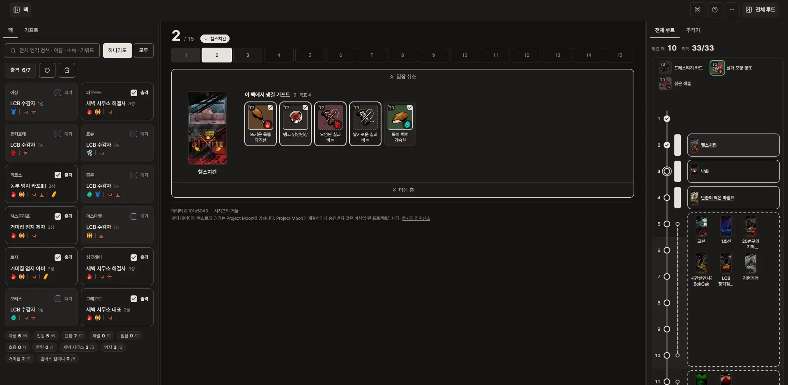
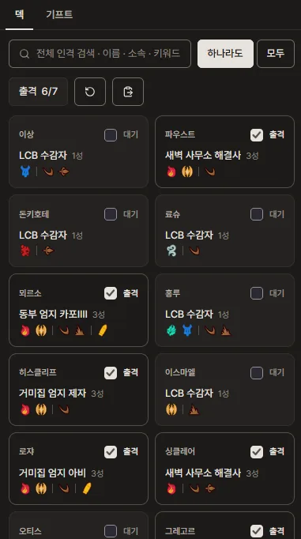
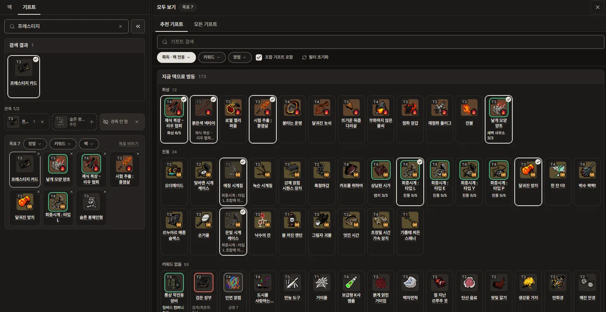
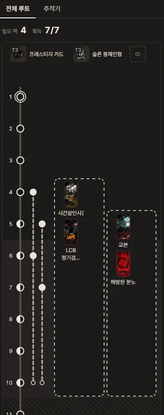
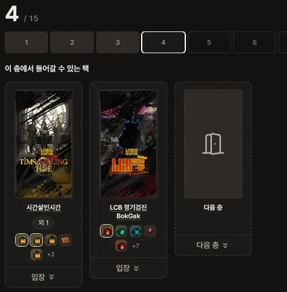
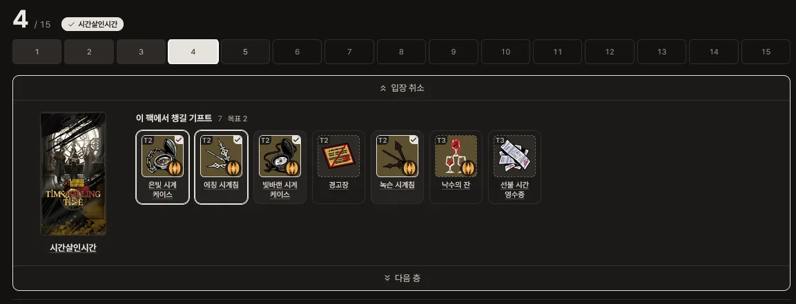
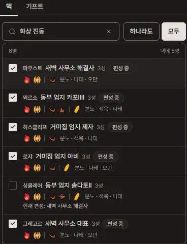
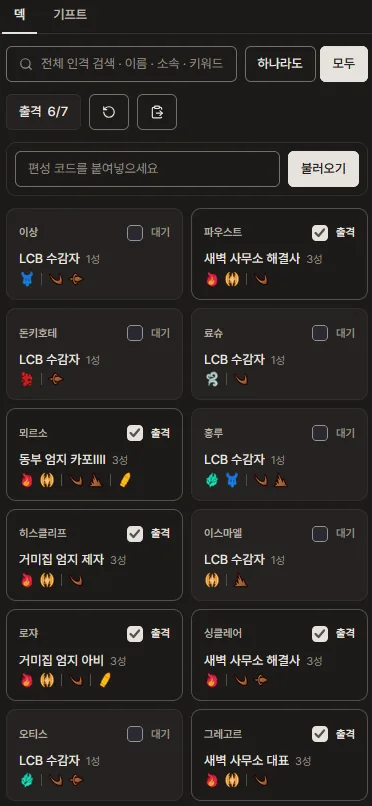
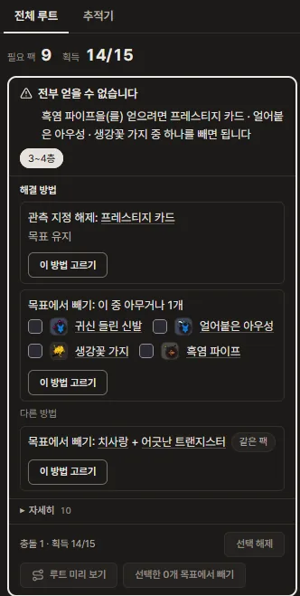
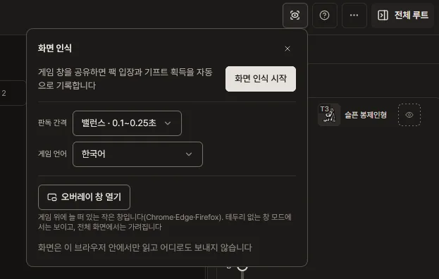

<!-- 이 파일은 docs/copy.md의 「README」에서 `npm run copy`가 만듭니다. 고칠 때는 그 파일을 고치세요. -->
# 거울 던전 루트 플래너

림버스 컴퍼니 **거울 던전**에서 원하는 E.G.O 기프트를 모으려면 **몇 층에서 어느 테마팩에 들어가야 하는지** 계산해 주는 웹 도구입니다.

**[사이트 열기](https://yujia-cha.github.io/mirror-dungeon/)**



## 기능

- **루트 계산** : 덱과 목표 기프트를 고르면, 루트를 계산해 보여줍니다.
- **조건 판정** : 조건부 기프트가 지금 덱으로 발동하는지 보여줍니다.
- **충돌 처리** : 기프트를 모두 얻을 수 없으면, 무엇을 빼면 되는지 알려줍니다.
- **기록 추적** : 게임을 하며 팩 입장과 기프트 획득을 기록하면, 남은 루트를 재계산합니다.

## 빠른 시작



1. **덱 설정** : 편성 코드를 붙여 넣거나 인격을 직접 고릅니다.



2. **목표 설정** : 원하는 기프트의 아이콘을 눌러 목표에 넣습니다.



3. **루트 확인** : 층마다 어느 팩을 입장해야 하는지 확인합니다.




4. **게임 시작** : 게임을 하며 스테이지에서 들어간 팩과 얻은 기프트를 기록합니다.

## 덱




- 「코드 가져오기」에 인게임 덱의 편성 코드를 붙여넣어 덱을 빠르게 편성할 수 있습니다.
- 수감자 칸을 눌러 인격을 고르거나, 검색해서 원하는 인격을 편성할 수 있습니다.
- 칸의 「대기」를 눌러 「출격」으로 바꿉니다.
- 인격 검색은 이름/소속/키워드/죄악으로 찾을 수 있습니다.

## 기프트


- 원하는 기프트를 검색하거나, 검색창 끝의 `>>`로 찾아 목표로 설정합니다.
- 아이콘을 누르면 **목표에 추가**, 이름을 누르면 설명이 열립니다.
- 조합 기프트를 목표로 하면 재료도 목표로 포함합니다.
- **관측 칸**에 넣은 기프트는 「기프트 관측」으로 받는 것으로 계획합니다. 1층을 떠나면 바꿀 수 없습니다.

## 루트


- 오른쪽 「전체 루트」가 층마다 들어갈 팩을 노선도로 그립니다.
- 팩 이름을 누르면 그 팩에서만 얻는 기프트가 나옵니다.



- 목표로 한 기프트를 전부 얻을 수 없으면, 카드가 **해결 방법**을 좋은 순서로 늘어놓습니다.
- 「이 방법 고르기」 → 「루트 미리 보기」로 확인하고, 「선택한 n개 목표에서 빼기」로 반영합니다.

## 런


- 스테이지의 팩 카드를 아래로 당기거나 「입장」 버튼을 눌러 입장하면, 그 팩에서 챙길 기프트가 나옵니다. 얻은 기프트는 아이콘을 눌러 획득으로 표시할 수 있습니다.
- 표시하지 않고 층을 떠나면 「미획득」으로 기록되고, 루트가 남은 층에서 다시 찾습니다.
- 열린 카드를 아래로 당기거나 「다음 층」버튼을 눌러 다음 층으로 이동합니다.
- 열린 카드를 위로 밀거나 「입장 취소」버튼을 눌러 되돌립니다.
- 계획에 없는 팩에 들어가도 됩니다. 루트는 지금 층부터 다시 계산됩니다.

### 화면 인식 · 오버레이 (데스크톱)



- 헤더의 「화면 인식」으로 게임 창을 공유하면 팩 입장, 기프트 획득/판매/합성을 자동으로 기록합니다.
- 「오버레이 창 열기」는 다음 층의 추천 팩과 남은 기프트를 보여 주는 오버레이 창을 띄워 줍니다. (Chrome·Edge 116 이상, Firefox 151 이상, 테두리 없는 창 모드)
- 화면은 브라우저 안에서만 읽고 어디로도 보내지 않습니다. 지금은 한국어 클라이언트만 지원합니다.

## 공유와 설정

- ⋯ 메뉴의 「링크 복사」는 덱, 목표 기프트, 설정을 담은 링크를 만듭니다.
- 「테마 변경」,「기프트 아이콘 크기」,「글자 크기」도 ⋯ 메뉴에 있습니다.
- 모든 기록은 이 브라우저에만 저장되고 서버로 가지 않습니다.

## 피드백

버그나 데이터 오류는 ⋯ 메뉴의 「피드백 보내기」로 알려 주세요. 공개 GitHub 이슈로 열리고, 덱, 목표 기프트, 설정과 체크한 기록이 함께 붙습니다(게임 화면은 보내지 않습니다).

## 데이터와 권리

게임 데이터·텍스트·이미지의 권리는 **Project Moon**에 있습니다. 이 저장소는 비상업 팬 프로젝트이며 Project Moon과 제휴하거나 승인받지 않았습니다.

- 게임 데이터는 플래너가 동작하는 데 필요한 범위에서 [LEAGUE-OF-NINE/OpenLethe](https://github.com/LEAGUE-OF-NINE/OpenLethe)(클라이언트 정적 데이터), [x1bViolet/Limbus-Localization-Files](https://github.com/x1bViolet/Limbus-Localization-Files)(공식 한국어·영어 현지화 원문), [eldritchtools/limbus-assets](https://github.com/eldritchtools/limbus-assets)(정적 데이터에 없는 인격을 채우는 가공 데이터)에서 가져옵니다. 자세한 것은 [`data/README.md`](data/README.md)와 [`data/sources.lock.json`](data/sources.lock.json)에 있습니다.
- 게임 이미지는 **기프트 아이콘·키워드 아이콘·테마팩 그림**만 담습니다(eldritchtools/limbus-assets 사본). 그 밖의 게임 이미지는 담지 않습니다.
- **코드는 MIT 라이선스입니다. 게임 데이터·텍스트·이미지에는 적용되지 않습니다** — [`NOTICE`](NOTICE)를 보세요.

## 개발

```bash
npm ci
npm run data:build   # 동봉된 원본 데이터로 게임 데이터 생성
npm run dev          # 개발 서버
npm run check        # lint + typecheck + 문구 생성물 + test + 데이터 검증
```

루트 계산 방식은 [`docs/route-algorithm.md`](docs/route-algorithm.md), 데이터 출처와 가공은 [`data/README.md`](data/README.md)에 있습니다. 화면 문구·설명서·이 README는 [`docs/copy.md`](docs/copy.md) 한 파일에서 고치고 `npm run copy`로 반영합니다.
